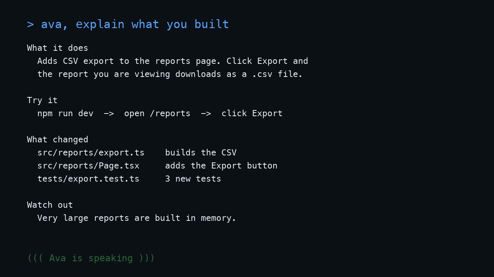

# Ava

A [Claude Code](https://code.claude.com) skill that talks back.

When Claude finishes building something, ask Ava. She writes a clear debrief in the chat, then says the short version out loud, so you can hear what happened without reading a wall of terminal output.

[](assets/demo.mp4)

▶️ [Watch the demo (sound on)](assets/demo.mp4). It shows an example session.

## Install

```bash
git clone https://github.com/Manukrish2504/Ava.git ~/.claude/skills/ava
```

Start a new Claude Code session and the skill is ready.

### Get the Ava voice (macOS)

Ava speaks with the macOS **Ava (Premium)** voice. To install it:

1. Open **System Settings → Accessibility → Read & Speak** (called **Spoken Content** on older macOS).
2. Click the arrows next to **System voice** and choose **Manage Voices…**
3. Under **English**, download **Ava (Premium)**.

Check that it works:

```bash
say -v "Ava (Premium)" "Ava online."
```

If the voice isn't installed, Ava uses your default system voice and tells you once.

## How to use it

Once Claude has finished a task, just ask.

### Explain what was built

```
> ava, explain what you built
```

In the chat:

```
What it does
  Adds CSV export to the reports page. Click Export and
  the report you are viewing downloads as a .csv file.

Try it
  npm run dev  ->  open /reports  ->  click Export

What changed
  src/reports/export.ts    builds the CSV
  src/reports/Page.tsx     adds the Export button
  tests/export.test.ts     3 new tests

Watch out
  Very large reports are built in memory.
```

Out loud:

> 🔊 "CSV export is done. The reports page has a new Export button, and it downloads the report you're looking at as a CSV file. I added the export logic, the button, and three tests, and they all pass. One thing to watch: very large reports are built in memory, so they could get slow."

### Recap everything that ran

```
> ava, tell me everything you ran
```

In the chat:

```
1. npm install papaparse     added 1 package
2. npm test                  2 failed in export.test.ts
     Expected "a,b,c" but received "a;b;c"
3. Fixed the delimiter in src/reports/export.ts
4. npm test                  14 passed, 0 failed
5. npm run lint              no problems

Now: feature done, all tests green, nothing committed.
```

Out loud:

> 🔊 "Here's the run. I installed one package for writing CSV files. The first test run had two failures, because I used semicolons instead of commas. I fixed the delimiter, and the second run passed, all fourteen tests. Lint came back clean. The feature is done, and nothing is committed yet."

### Ask for one slice

```
> ava, just the errors
> ava, only the test results
> ava, what did the build print?
```

### Keep it quiet

Add **"text only"**, **"quiet"**, or **"don't speak"** and Ava skips the voice and only writes in the chat.

```
> ava, explain what you built, text only
```

## Phrases that trigger Ava

You don't have to say "ava". Any of these work after a task:

- "explain what you built"
- "talk me through it"
- "what did you just do?"
- "tell me what happened in the terminal"
- "read me the output"
- "recap the session"

## How it works

Ava is a single [`SKILL.md`](SKILL.md) file. It tells Claude to:

1. **Pick a mode.** *Explain* covers what the feature does, how to try it, what changed, and what to watch out for. *Recap* walks through every command in order, with the output that matters.
2. **Use evidence.** Ava reports from what actually happened, and checks `git status` and `git diff` when Claude's memory of the session is thin. Failed tests and skipped steps get reported, not hidden.
3. **Write the full details in the chat.**
4. **Speak a short version** (about 30 to 60 seconds) with macOS `say -v "Ava (Premium)"`, written for listening: no code, no file paths, no symbols.

## Requirements and limits

- macOS for the voice. On other systems Ava still writes the debrief, just silently.
- Claude Code.
- Ava only knows about commands Claude ran, plus ones you run inside Claude Code with `!`. She can't see output from your other terminal windows. Paste it in, or rerun the command with `!`.
